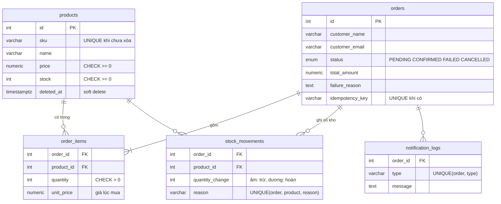
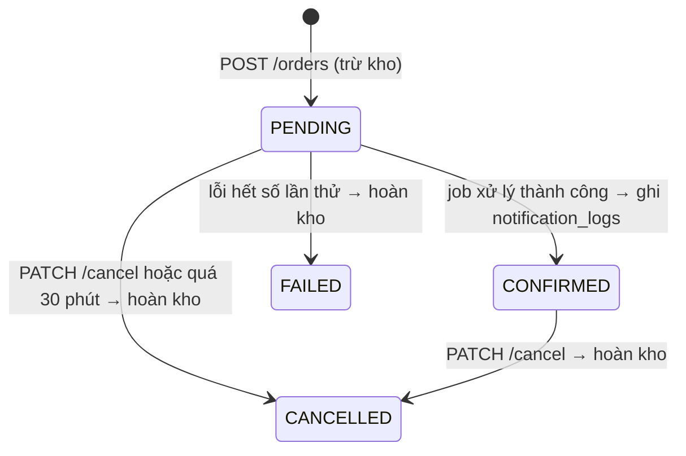

# Mini Order Management API

Backend quản lý sản phẩm, tồn kho và đơn hàng cho một cửa hàng online nhỏ.
Đơn hàng được xác nhận **bất đồng bộ** bởi một worker BullMQ, khách không phải chờ.

**Stack:** NestJS 11 · PostgreSQL + TypeORM (migration, không dùng `synchronize`) · BullMQ + Redis · Swagger

| | Link |
|---|---|
| API (Vercel) | https://pham-duc-tien-fresher-node-js.vercel.app |
| Swagger | https://pham-duc-tien-fresher-node-js.vercel.app/api/docs |
| Worker (Render, health) | https://mini-order-worker.onrender.com |

Dữ liệu mẫu trên bản deploy: 4 sản phẩm (id 1–4), trong đó `CAP-LIMITED` chỉ còn 1 cái để thử trường hợp hết hàng.

### Thử nhanh trên bản deploy
```bash
API=https://pham-duc-tien-fresher-node-js.vercel.app

# Đặt đơn (PENDING) → khoảng 5–15 giây sau GET lại sẽ thấy CONFIRMED
curl -X POST $API/orders -H 'content-type: application/json' \
  -d '{"customerName":"Nguyen Van A","customerEmail":"a@example.com","items":[{"productId":1,"quantity":2}]}'
curl $API/orders/1
curl $API/orders/1/jobs          # trạng thái job, số lần thử, lỗi gần nhất

# Hết hàng → 409 INSUFFICIENT_STOCK
curl -X POST $API/orders -H 'content-type: application/json' \
  -d '{"customerName":"B","customerEmail":"b@example.com","items":[{"productId":4,"quantity":2}]}'

# Gửi lại cùng Idempotency-Key → lần 2 trả 200 và cùng một đơn
curl -X POST $API/orders -H 'content-type: application/json' -H 'Idempotency-Key: demo-123' \
  -d '{"customerName":"C","customerEmail":"c@example.com","items":[{"productId":2,"quantity":1}]}'

# Bắn đơn song song vào bản deploy (chạy trong thư mục repo)
BASE_URL=$API PARALLEL=10 STOCK=2 npm run test:oversell
```

---

## 1. Chạy local

Yêu cầu: Node.js ≥ 20, Docker (hoặc Postgres 14+ và Redis 6.2+ cài sẵn).

```bash
npm install
cp .env.example .env          # mặc định trỏ tới Postgres/Redis local
docker compose up -d          # Postgres 16 + Redis 7
npm run migration:run         # tạo bảng
npm run start:dev             # API + worker (RUN_WORKER=true trong .env)
```

- API: http://localhost:3000 · Swagger: http://localhost:3000/api/docs
- Muốn chạy worker thành process riêng (giống production): đặt `RUN_WORKER=false`, rồi chạy thêm `npm run start:worker:dev`.

| Lệnh | Việc |
|---|---|
| `npm test` | Unit test (OrdersService, worker) |
| `npm run test:oversell` | Bắn nhiều đơn song song vào API đang chạy, kiểm tra không bán vượt tồn |
| `npm run migration:run` / `migration:revert` | Chạy / hoàn tác migration |
| `npm run build && npm run start:prod` | Chạy bản build |
| `npm run start:worker` | Chạy worker từ bản build |

Biến môi trường: xem [.env.example](.env.example). App kiểm tra biến môi trường khi khởi động và dừng ngay nếu thiếu hoặc sai.

---

## 2. Cấu trúc

```
src/
├── main.ts / app.module.ts      HTTP API
├── worker.ts / worker.module.ts Worker chạy riêng (không có controller)
├── serverless.ts                Entry cho Vercel
├── infrastructure.module.ts     Config + TypeORM + kết nối Redis (dùng chung API & worker)
├── products/                    CRUD sản phẩm
├── orders/                      Đặt đơn, xem, hủy, trạng thái job
├── inventory/                   Mọi thay đổi tồn kho + sổ kho (stock_movements)
├── queue/                       Producer, worker xử lý đơn, job dọn đơn quá hạn
├── common/                      Filter lỗi, phân trang, tiện ích
└── database/                    Cấu hình TypeORM + migrations
```

---

## 3. Data model



Những ràng buộc ở tầng database (lớp bảo vệ cuối cùng, kể cả khi code có lỗi):

- `products.stock >= 0` (CHECK): không thể có tồn kho âm.
- SKU unique **chỉ giữa các sản phẩm chưa xóa** (partial unique index), nên xóa mềm xong vẫn dùng lại được SKU cũ.
- `order_items (order_id, product_id)` unique: mỗi sản phẩm một dòng trong đơn (số lượng được cộng dồn khi tạo).
- `stock_movements (order_id, product_id, reason)` unique: mỗi đơn chỉ được hoàn kho **một lần**.
- `notification_logs (order_id, type)` unique: mỗi đơn chỉ có **một** email xác nhận.
- `orders.idempotency_key` unique (khi có): một key chỉ ứng với **một** đơn.
- `unit_price` lưu giá lúc mua, đổi giá sản phẩm sau đó không ảnh hưởng đơn cũ.

Schema thay đổi qua 2 migration: `InitSchema` và `AddOrderIdempotencyKey`.

---

## 4. Luồng đơn hàng



**POST /orders**, trong **một transaction**:

1. Nếu có `Idempotency-Key` và key đã dùng thì trả lại đơn cũ (200), không làm gì thêm.
2. Gộp các item trùng `productId`, sắp xếp theo `productId`.
3. Với từng sản phẩm: `UPDATE products SET stock = stock - :qty WHERE id = :id AND deleted_at IS NULL AND stock >= :qty`.
   Không cập nhật được dòng nào thì trả về 404 (sản phẩm không tồn tại) hoặc 409 `INSUFFICIENT_STOCK`, và **rollback toàn bộ**, kể cả các sản phẩm đã trừ trước đó.
4. Lưu đơn `PENDING` + `order_items` (giá lúc mua) + sổ kho `ORDER_PLACED`.
5. **Sau khi commit** mới thêm job `process-order` vào queue `order-processing` (jobId = `order-<id>`).

**Worker** (`process-order`):

1. Đơn không còn `PENDING` (đã hủy, đã xử lý) thì bỏ qua.
2. Giả lập xử lý 3–5 giây, lỗi ngẫu nhiên khoảng 30%.
3. Thành công thì `PENDING → CONFIRMED` + ghi `notification_logs` (thay cho gửi email).
4. Lỗi thì BullMQ retry với **exponential backoff** (1s, 2s...). Lần thử cuối vẫn lỗi thì `PENDING → FAILED` + hoàn kho.

**Job định kỳ** `cleanup-expired-orders` (5 phút/lần, BullMQ Job Scheduler), là lưới an toàn cho đơn `PENDING`:
1. Đơn `PENDING` quá 1 phút mà **chưa có job** (ví dụ Redis lỗi đúng lúc đặt đơn) thì **thêm lại job**, để đơn vẫn được xử lý.
2. Đơn vẫn `PENDING` quá 30 phút thì hủy và hoàn kho.

---

## 5. Đúng đắn khi có nhiều request đồng thời

### Không bán vượt tồn kho
- Trừ kho bằng **một câu UPDATE có điều kiện** `stock >= qty`, không làm kiểu "đọc tồn kho lên code rồi ghi lại".
  Postgres khóa dòng khi UPDATE. Hai đơn tranh món cuối cùng thì đơn thứ hai phải chờ đơn thứ nhất commit, sau đó Postgres kiểm tra lại điều kiện `stock >= qty`, thấy không còn đủ, nên khớp 0 dòng và đơn đó bị từ chối.
- Khóa các sản phẩm **theo thứ tự productId** để hai đơn cùng chứa sản phẩm A và B không khóa chéo nhau (deadlock).
- CHECK `stock >= 0` trong DB là lớp chặn cuối cùng.
- Kiểm chứng bằng `npm run test:oversell`:

  | Môi trường | Đơn gửi song song | Tồn kho | Thành công (201) | Bị từ chối (409) | Tồn kho sau |
  |---|---|---|---|---|---|
  | Local | 20 | 3 | 3 | 17 | 0 |
  | Local | 50 | 7 | 7 | 43 | 0 |
  | Production (Vercel + Neon) | 10 | 2 | 2 | 8 | 0 |

### Gửi lại request không tạo đơn trùng (`Idempotency-Key`)
Client gửi kèm header `Idempotency-Key` (ví dụ một UUID cho mỗi lần bấm "Đặt hàng"). Mạng chập chờn hay khách bấm 2 lần thì request lặp lại sẽ nhận **đơn cũ** (200) thay vì tạo đơn mới (201).
Hai request cùng key đến **cùng lúc**: unique index chỉ cho một bên insert thành công. Transaction của bên còn lại bị rollback (kho của nó được trả lại tự động) và bên đó trả về đơn của bên thắng.
Đã thử với DB thật: 5 request song song cùng key cho ra 1 lần 201 và 4 lần 200, cùng một đơn, kho chỉ bị trừ một lần.

### Idempotent: retry hay job trùng không gây tác dụng phụ
- **Không tạo job trùng:** `jobId = order-<id>`. BullMQ bỏ qua `add()` nếu job cùng id đã tồn tại.
- **Chuyển trạng thái có điều kiện:** mọi chuyển trạng thái đều là `UPDATE orders SET status = :to WHERE id = :id AND status IN (:from)`. Job chạy lại, hoặc hủy đơn chạy đua với worker, thì chỉ một bên khớp được dòng.
- **Hoàn kho đúng một lần:** đi qua **một hàm duy nhất** (`closeAndReleaseStock`) gồm chuyển trạng thái có điều kiện, rồi ghi sổ kho bằng `INSERT ... ON CONFLICT DO NOTHING`, và chỉ cộng lại tồn kho cho những dòng sổ kho vừa thêm được. Gọi hai lần cho cùng một đơn thì lần hai không thay đổi gì.
- **Không gửi trùng thông báo:** `notification_logs` có UNIQUE `(order_id, type)` và insert dùng `ON CONFLICT DO NOTHING`.

### Vì sao thêm job **sau** khi commit
Nếu thêm job bên trong transaction, worker có thể chạy trước khi đơn được commit (không tìm thấy đơn), hoặc chạy cho một đơn đã bị rollback.
Đổi lại phải xử lý trường hợp **Redis lỗi đúng lúc thêm job**:
- Đơn vẫn được lưu `PENDING` và lỗi được ghi log, khách vẫn nhận được đơn.
- Job định kỳ (5 phút/lần) thấy đơn `PENDING` quá 1 phút mà chưa có job thì **thêm lại job**, nên đơn **vẫn được xử lý** chứ không bị bỏ. Việc này an toàn vì `jobId = order-<id>` cố định: đơn đã có job thì bỏ qua, không bao giờ tạo job thứ hai.
- Quá 30 phút mà vẫn `PENDING` thì mới hủy và hoàn kho, là lớp cuối cùng nên không có đơn nào giữ kho mãi mãi.
- Đã thử với DB và Redis thật: tạo một đơn `PENDING` không có job, job định kỳ thêm lại job, đơn chuyển `CONFIRMED`, đúng 1 thông báo.

Hướng làm chặt hơn: **outbox table** (ghi "cần thêm job" trong cùng transaction, một tiến trình đẩy vào queue ngay), không phải đợi chu kỳ 5 phút.

---

## 6. API

| Method | Path | Ghi chú |
|---|---|---|
| POST | `/products` | 409 `SKU_TAKEN` nếu trùng SKU |
| GET | `/products` | `page`, `limit` (≤100), `search` (tên, không phân biệt hoa thường), `minPrice`, `maxPrice` |
| GET / PATCH / DELETE | `/products/:id` | PATCH chỉ ghi các field được gửi; DELETE là xóa mềm (204) |
| POST | `/orders` | `customerName`, `customerEmail`, `items[{productId, quantity}]`; header tùy chọn `Idempotency-Key` |
| GET | `/orders` | `page`, `limit`, `status` |
| GET | `/orders/:id` | Kèm danh sách sản phẩm (kể cả sản phẩm đã xóa mềm) |
| PATCH | `/orders/:id/cancel` | Chỉ khi `PENDING`/`CONFIRMED`, hoàn kho; nếu không thì 409 `ORDER_NOT_CANCELLABLE` |
| GET | `/orders/:id/jobs` | Trạng thái job, số lần thử, lỗi gần nhất |

Chi tiết request/response: Swagger tại `/api/docs`.

### Format lỗi thống nhất
```json
{
  "statusCode": 409,
  "error": "Conflict",
  "code": "INSUFFICIENT_STOCK",
  "message": "Not enough stock for product 1: requested 99, available 2",
  "path": "/orders",
  "timestamp": "2026-10-16T03:03:34.653Z"
}
```
- **400:** dữ liệu không hợp lệ. `message` là mảng lỗi; field lạ bị từ chối.
- **404:** không tìm thấy (`PRODUCT_NOT_FOUND` khi đặt đơn).
- **409:** xung đột nghiệp vụ (`INSUFFICIENT_STOCK`, `SKU_TAKEN`, `ORDER_NOT_CANCELLABLE`) hoặc vi phạm ràng buộc DB (unique / foreign key / check).
- **500:** lỗi không mong đợi, có ghi log đầy đủ nhưng không trả stack trace ra ngoài.

---

## 7. Test

- `npm test`: 16 unit test.
  - **OrdersService:** tạo đơn thành công (gộp item, giá, job thêm sau khi ghi đơn), không đủ tồn kho (không lưu, không thêm job), Redis lỗi khi thêm job, gửi lại `Idempotency-Key`, hai request cùng key chạy đua, hủy đơn hoàn kho, hủy đơn không hợp lệ, confirm idempotent.
  - **Worker:** thành công, lỗi còn lượt thử (ném lỗi để BullMQ retry), lỗi ở lần cuối (FAILED + hoàn kho), bỏ qua đơn không còn PENDING, job định kỳ gọi đủ hai bước (hủy đơn quá hạn, thêm lại job thiếu).
  - **Thêm lại job:** đơn đã có job thì không thêm job thứ hai; đơn thiếu job thì thêm với đúng `jobId` và cấu hình retry; chỉ đếm những đơn thực sự được thêm.
- `npm run test:oversell`: kiểm tra đồng thời trên API thật, xem mục 5.
- Đã chạy tay với DB thật: luồng FAILED sau 3 lần thử (kho được hoàn), job dọn dẹp hủy đơn PENDING quá hạn.

Một lỗi chỉ bắt được khi test với DB thật: `manager.query()` của TypeORM (driver Postgres) trả về `[rows, affectedCount]` cho câu UPDATE, nên kiểm tra kiểu `rows.length === 0` luôn sai. Đã chuyển sang QueryBuilder (`.returning()` + `affected`), và script test đồng thời giờ chạy đúng.

---

## 8. Deploy

```
            ┌────────────────────┐   thêm job    ┌──────────────────────┐
  client ──▶│  API (Vercel)      │──────────────▶│  Redis (Upstash /    │
            │  serverless        │               │  Redis Cloud)        │
            └─────────┬──────────┘               └──────────┬───────────┘
                      │                                     │ lấy job
                      ▼                                     ▼
            ┌────────────────────┐   cập nhật    ┌──────────────────────┐
            │ Postgres (Neon)    │◀──────────────│  Worker (Render)     │
            └────────────────────┘               │ process chạy liên tục│
                                                 └──────────────────────┘
```

**Vì sao worker không chạy trên Vercel:** Vercel chạy code dưới dạng serverless function. Function chỉ sống trong lúc xử lý một request, sau đó bị đóng băng hoặc tắt, không có process nào chạy nền để lắng nghe queue. Worker BullMQ cần một process chạy liên tục, nên tách ra:

- **API → Vercel.** `api/index.js` gọi Nest app đã build (`src/serverless.ts`). API chỉ **thêm** job vào Redis, không xử lý job.
- **Worker → Render** (Web Service, chạy `npm run start:worker`). Gói miễn phí của Render bắt process phải mở một cổng, nên worker có endpoint health tùy chọn (`WORKER_HEALTH_PORT`).
  - Hạn chế của gói miễn phí: service **ngủ sau khoảng 15 phút** không có request HTTP. Đã cấu hình **UptimeRobot** gọi endpoint health mỗi 5 phút để worker luôn thức. Nếu worker vẫn bị ngủ, job nằm an toàn trong Redis và được xử lý khi worker thức dậy.
  - Lựa chọn khác: Railway hoặc Fly.io (có loại "worker" không cần mở cổng), hoặc Render Background Worker (trả phí).
- **Postgres → Neon**, **Redis → Upstash hoặc Redis Cloud.**

**Các bước:**
1. Tạo database Neon, chạy migration từ máy: `DATABASE_URL=<neon-url> DATABASE_SSL=true npm run migration:run`.
2. Tạo Redis (`rediss://...`). BullMQ yêu cầu eviction policy là `noeviction`.
3. Vercel: import repo GitHub, đặt biến môi trường `DATABASE_URL`, `DATABASE_SSL=true`, `REDIS_URL`, `RUN_WORKER=false`.
4. Render: tạo Web Service từ repo, build `npm install && npm run build`, start `npm run start:worker`, đặt cùng các biến môi trường và `WORKER_HEALTH_PORT=10000`.

---

## 9. Giả định và đánh đổi

- **"Retry tối đa 3 lần":** hiểu là **tổng cộng 3 lần chạy** (`attempts: 3`, lần đầu + 2 lần retry), theo câu "hết 3 lần mà vẫn lỗi thì FAILED". Muốn 1 lần đầu + 3 lần retry thì đặt `ORDER_JOB_ATTEMPTS=4`.
- **Hủy đơn CONFIRMED** vẫn hoàn kho (theo đề). Đơn đã hủy hoặc đã FAILED thì không hủy lại được (409).
- **`Idempotency-Key`:** request lặp lại nhận lại đơn cũ, không so sánh nội dung body (có thể bổ sung: lưu hash của body và trả 422 nếu cùng key mà khác nội dung).
- **Giá:** `numeric(12,2)` trong DB, trả về dạng number trong API. Đủ chính xác cho giá có 2 chữ số thập phân; nếu xử lý tiền phức tạp hơn thì nên dùng đơn vị nhỏ nhất (integer) hoặc thư viện decimal.
- **Sửa `stock` qua PATCH** là admin đặt lại giá trị tuyệt đối. Các field khác không ghi đè `stock` (dùng `UPDATE` chỉ với field được gửi).
- **Tìm kiếm** dùng `ILIKE`, đủ cho dữ liệu nhỏ. Dữ liệu lớn nên dùng index `pg_trgm`.
- **Job dọn dẹp** xử lý tối đa 100 đơn mỗi lần chạy. Mỗi đơn là một transaction ngắn để không khóa lâu.

## 10. Chưa làm / có thể cải thiện

- Outbox pattern cho việc thêm job (hiện dùng job định kỳ thêm lại job thiếu, chậm nhất 5 phút).
- E2E test chạy với Postgres/Redis thật trong CI (hiện có script `test:oversell` chạy tay).
- Cảnh báo khi job FAILED, dashboard queue (ví dụ Bull Board).
- Không có xác thực, phân quyền, thanh toán, frontend (ngoài phạm vi đề).

---

Có dùng AI hỗ trợ (theo cho phép của đề). Mọi quyết định thiết kế và từng phần code đều đã được đọc, chạy thử và có thể giải thích.
